<a href="https://tm-541.github.io/Portfolio/"><picture><source media="(prefers-color-scheme: light)" srcset="assets/light/banner.svg"></picture></a>

<a href="https://tm-541.github.io/Portfolio/#about"><picture><source media="(prefers-color-scheme: light)" srcset="assets/light/about.svg"></picture></a>

<a href="https://github.com/TM-541/AEGISINTEL"><picture><source media="(prefers-color-scheme: light)" srcset="assets/light/project-aegisintel.svg"></picture></a>

<a href="https://github.com/TM-541/AI-Secure-Policy-RAG-Assistant"><picture><source media="(prefers-color-scheme: light)" srcset="assets/light/project-rag.svg"></picture></a>
<a href="https://github.com/TM-541/AEGIS-LN"><picture><source media="(prefers-color-scheme: light)" srcset="assets/light/project-aegis-ln.svg"></picture></a>

<a href="https://tm-541.github.io/Portfolio/#research"><picture><source media="(prefers-color-scheme: light)" srcset="assets/light/research.svg"></picture></a>

<a href="https://tm-541.github.io/Portfolio/#experience"><picture><source media="(prefers-color-scheme: light)" srcset="assets/light/experience.svg"></picture></a>

<a href="https://tm-541.github.io/Portfolio/#education"><picture><source media="(prefers-color-scheme: light)" srcset="assets/light/credentials.svg"></picture></a>

<a href="https://tm-541.github.io/Portfolio/#certifications"><picture><source media="(prefers-color-scheme: light)" srcset="assets/light/toolkit.svg"></picture></a>

  <a href="https://tm-541.github.io/Portfolio/"><picture><source media="(prefers-color-scheme: light)" srcset="assets/light/btn-portfolio.svg"></picture></a>
  &nbsp;
  <a href="https://www.linkedin.com/in/muhammadtalha-cybersecurity"><picture><source media="(prefers-color-scheme: light)" srcset="assets/light/btn-linkedin.svg"></picture></a>

